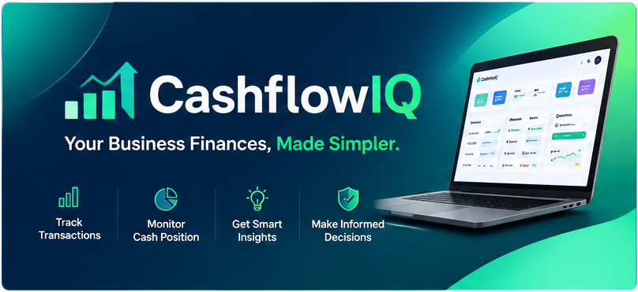
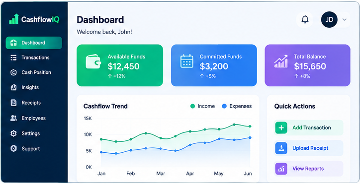
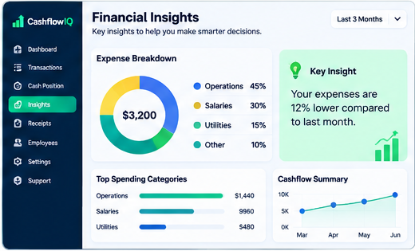
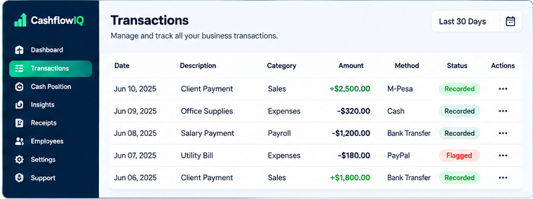
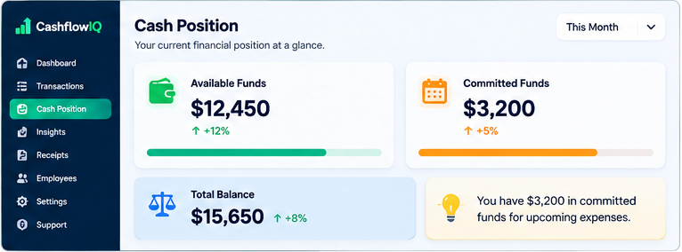

# CASHFLOWIQ

### Your Business Finances, Made Simpler.

**An End-to-End Product Management Case Study**

From Problem Discovery to Product Strategy, Development & Launch.

 

 

<!-- Replace with the actual project banner -->

 

[Project Overview](#-project-overview) •
[Discovery](#-phase-1--discovery) •
[Planning](#-phase-2--planning) •
[Execution](#-phase-3--execution) •
[Prototypes](#-product-design--prototypes)

---

## 📌 PROJECT OVERVIEW

CashflowIQ is a product management portfolio project focused on designing a practical, accessible financial management solution for small businesses and startups.

The project addresses a common challenge among growing businesses: limited visibility into their actual financial position.

Business owners often record daily income and expenditure but struggle to distinguish available funds from committed funds, monitor financial activity, identify discrepancies and make informed financial decisions.

**CashflowIQ aims to simplify this experience by bringing essential financial management capabilities into one centralised platform.**

| Project Information | Details |
|:---|:---|
| Product | CashflowIQ |
| Category | FinTech / Financial Management |
| Project Type | End-to-End Product Management |
| Target Audience | Small Businesses & Startups |
| Product Approach | Research-driven and customer-centric |
| Project Phases | Discovery, Planning & Execution |
| Primary Deliverables | Research, Strategy, PRD, Roadmap, Designs, HTML Prototypes & Launch Plan |

## 🎯 THE PROBLEM

Small businesses frequently encounter financial management challenges that affect their ability to operate efficiently and make informed decisions.

The key problems identified include:

- **Limited Financial Visibility:** Difficulty understanding the business's current financial position.
- **Cashflow Mismanagement:** Confusing money in the account with money available to spend.
- **Untracked Commitments:** Failure to account for salaries, outstanding expenses and other financial obligations.
- **Financial Leakage:** Unrecorded transactions and inadequate employee accountability.
- **Manual Reconciliation:** Difficulty verifying financial transactions across different payment channels.
- **Delayed Decisions:** Lack of accessible financial information for timely business decisions.

### The Opportunity

Build a straightforward financial management product that helps business owners understand where their money comes from, where it goes and how much is actually available.

---

## 💡 PRODUCT VISION

> To make business financial management simpler, more transparent and more accessible to small businesses.

### Core Value Proposition

**Your Business Finances, Made Simpler.**

CashflowIQ provides business owners with a consolidated view of their financial activities, available funds, commitments and financial insights.

### Product Objectives

1. Improve real-time financial visibility.
2. Simplify daily income and expenditure tracking.
3. Differentiate available funds from committed funds.
4. Improve transaction accountability and traceability.
5. Identify potential financial leakage.
6. Support informed financial decisions.

---

# 🗺️ PRODUCT DEVELOPMENT JOURNEY

The project follows three structured product management phases.

| PHASE 01 | PHASE 02 | PHASE 03 |
|:---:|:---:|:---:|
|  **DISCOVERY** |  **PLANNING** |  **EXECUTION** |
| Understand the problem | Define the solution | Build and launch |
| Customer Research | Product Strategy | Development |
| Problem Validation | Product Requirements | Product Prototypes |
| Market Analysis | Product Design | Launch Strategy |

---

# 🔍 PHASE 1 – DISCOVERY

**Objective:** Understand the problem, customers, market opportunity and existing financial management behaviours.

The Discovery phase established the foundation for CashflowIQ by identifying customer pain points, examining existing solutions and defining the opportunity for a new product.

### Key Activities

- Problem identification and definition.
- Customer research and interviews.
- Jobs-to-be-Done analysis.
- Customer journey mapping.
- Competitive analysis.
- User behaviour analysis.
- Historical and financial data analysis.
- Opportunity identification.
- Strategic problem prioritisation.

### Strategic Product Pillars

The research and prioritisation process identified five primary product priorities:

| # | Strategic Pillar | Product Objective |
|:---:|:---|:---|
| 01 | Real-Time Visibility | Give business owners a clear financial overview. |
| 02 | Available vs Committed Funds | Differentiate spendable money from financial obligations. |
| 03 | Daily Financial Tracking | Monitor daily income and expenditure. |
| 04 | Financial Leakage | Identify potential unexplained financial losses. |
| 05 | Cash Reconciliation | Improve transaction verification and accountability. |

Employee accountability was also considered an important supporting capability.

### 📂 Discovery Deliverables

<b>01. Problem Definition</b>

- Problem Statement
- Problem Analysis
- Opportunity Identification
- Product Opportunity Assessment

<b>02. Customer Research</b>

- Customer Research Documentation
- Customer Interview Guide
- Customer Interview Findings
- User Pain Points

<b>03. Customer Understanding</b>

- Jobs-to-be-Done Framework
- Customer Journey Map
- User Behaviour Analysis

<b>04. Market & Data Analysis</b>

- Competitive Analysis
- Historical Data Analysis
- Market Opportunity Assessment
- Strategic Prioritisation

<b>05. Discovery Summary</b>

- Consolidated Research Findings
- Validated Problem Areas
- Product Opportunities
- Discovery Phase Conclusion

**Phase Outcome:** A clearly defined product opportunity supported by customer understanding, market analysis and prioritised business problems.

[📁 Explore Phase 1 – Discovery](PHASE-1-DISCOVERY/)

---

# 📋 PHASE 2 – PLANNING

**Objective:** Translate discovery insights into a defined product strategy, requirements and solution design.

The Planning phase established what CashflowIQ would become, who it would serve, which problems it would solve and how its capabilities would be prioritised.

### Key Activities

- Product vision and strategy development.
- BIG S Strategy formulation.
- Product definition.
- Product requirements documentation.
- Feature prioritisation.
- Product roadmap development.
- User stories and acceptance criteria.
- Wireframing and interface design.
- Interactive prototyping.
- Customer prototype testing and feedback.

### BIG S STRATEGY

The BIG S Strategy established the overarching strategic direction connecting the product's mission and vision to its development priorities.

It provided the strategic framework for translating the identified business problem into a focused product solution.

### Product Design & Validation

An initial product prototype was developed to demonstrate the proposed solution and test its usability.

The prototype was tested with **10 customers**, and feedback was incorporated into the refinement process.

### 📂 Planning Deliverables

<b>01. Product Strategy</b>

- Product Vision
- BIG S Strategy
- Product Definition
- Strategic Objectives

<b>02. Product Requirements</b>

- Product Requirements Document (PRD)
- Functional Requirements
- Non-Functional Requirements
- User Stories
- Acceptance Criteria

<b>03. Product Prioritisation & Roadmap</b>

- Feature Prioritisation
- Product Roadmap
- Development Priorities
- Feature Scope

<b>04. Product Design</b>

(I am not a designer; hence, with the help of AI, I developed the prototypes)
- Wireframes
- UI/UX Designs
- User Flows
- Interactive Prototypes

<b>05. Customer Validation</b>

- Prototype Testing
- Customer Feedback
- Design Refinements
- Planning Phase Summary

**Phase Outcome:** A defined product strategy, prioritised requirements, structured roadmap and customer-tested solution concept.

[📁 Explore Phase 2 – Planning](PHASE-2-PLANNING/)

---

# 🚀 PHASE 3 – EXECUTION

**Objective:** Translate the product strategy and approved requirements into a tangible product experience and prepare it for market introduction.

Execution is the final phase of the CashflowIQ project.

It consists of two major workstreams:

- Development
- Launch

## 3.1 DEVELOPMENT

The Development workstream focuses on translating product requirements and designs into functional product interfaces and workflows.

### Product Development Scope

| Component | Description |
|:---|:---|
| Business Dashboard | Centralised overview of business finances. |
| Transaction Management | Daily income and expenditure tracking. |
| Add Transaction | Dedicated transaction recording panel. |
| Cash Position | Consolidated financial position. |
| Financial Insights | Visual financial indicators and insights. |
| Receipt Management | Upload and attach transaction receipts. |
| Employee Workflow | QR-based receipt submission and transaction recording. |
| Business Profiles | Separate business financial profiles. |
| Support Centre | FAQ-based product assistance. |

### Payment Methods

The product accommodates four transaction channels:

- Cash
- M-Pesa
- Bank Transfer
- PayPal

### Employee Transaction Workflow

Employee-submitted transactions are immediately displayed with a **Recorded** status.

Reconciliation and flagging are handled as separate statuses to maintain transaction traceability and accountability.

### 📂 Development Deliverables

- Final Product HTML Prototype.
- Dashboard Interface.
- Transaction Management Interface.
- Add Transaction Workflow.
- Cash Position Interface.
- Financial Insights Interface.
- Receipt Upload Workflow.
- Employee QR Receipt Scanning Workflow.
- Product Designs and Visual Assets.
- Product Landing Page.

[📁 Explore Development](PHASE-3-EXECUTION/DEVELOPMENT/)

---

## 3.2 LAUNCH

The Launch workstream focuses on product positioning, customer-facing communication, market introduction and customer acquisition.

### Launch Workstreams

| # | Workstream | Focus |
|:---:|:---|:---|
| 01 | Product Messaging | Positioning and value proposition. |
| 02 | Website & Landing Page | Customer-facing digital presence. |
| 03 | Customer Documentation | FAQs, guides and onboarding resources. |
| 04 | Tutorials & Webinars | Product education and demonstrations. |
| 05 | Announcements | Product launch communications. |
| 06 | External Announcement | External visibility and market introduction. |
| 07 | Customer Management | Acquisition, onboarding and engagement. |

### Customer Management Strategy

The initial customer acquisition strategy targets **200 Ideal Customer Profiles (ICPs)**.

Planned acquisition channels:

- LinkedIn outreach.
- Direct email outreach.
- Secondary connections and referrals.
- Social media content.
- Paid advertising after the initial 45-day period.

### 📂 Launch Deliverables

- Product Messaging Framework.
- Website and Landing Page.
- Customer Documentation.
- Product FAQs.
- Tutorials and Webinar Materials.
- Founder Announcement.
- External Announcement.
- Customer Acquisition Strategy.
- ICP Definition.
- Customer Onboarding Strategy.
- Customer Management Plan.
- Launch Summary.

[📁 Explore Launch](PHASE-3-EXECUTION/LAUNCH/)

---

# 🖥️ PRODUCT DESIGN & PROTOTYPES

The project includes HTML prototypes and visual design assets demonstrating the evolution of CashflowIQ from a product concept into a structured digital experience.

## Product Interface

### Business Dashboard

### Transaction Management

### Cash Position & Financial Insights

## HTML Prototypes

| Prototype | Description | Access |
|:---|:---|:---|
| CashflowIQ Product | Interactive financial management interface. | [Open HTML](https://github.com/ann-amboka/PRODUCT-MANAGEMENT-CASE-STUDY/blob/main/CashflowIQ-Product-Prototype.html) |
| CashflowIQ Website | Customer-facing product landing page. | [Open HTML](https://github.com/ann-amboka/PRODUCT-MANAGEMENT-CASE-STUDY/blob/main/CashflowIQ-Landing-Page.html) |

**Note:** These are HTML product prototypes and demonstrate the intended product experience. They should not be interpreted as a fully deployed production financial platform.

---

# 🛠️ TECHNOLOGY & TOOLS

| Category | Tools |
|:---|:---|
| Product Management | Product Strategy, PRDs, Roadmaps, Prioritisation |
| Data Analysis | SQL, Excel |
| Data Visualisation | Power BI |
| Product Design | AI, Prototyping |
| Documentation | Markdown |
| Research | Customer Interviews, Competitive Analysis |

---

# 🎬 PROJECT WALKTHROUGH

A complete walkthrough documents the end-to-end product management journey, including the research, strategic decisions, designs, prototypes and launch preparation.

| Section | Content |
|:---|:---|
| Part 1 | Problem Identification & Discovery |
| Part 2 | Customer Research & Analysis |
| Part 3 | Product Strategy & BIG S Strategy |
| Part 4 | Requirements & Product Roadmap |
| Part 5 | Product Design & Prototyping |
| Part 6 | Product Development |
| Part 7 | Website & Final Product |
| Part 8 | Launch & Customer Management |

**Video:** [Project Walkthrough – Coming Soon](PROJECT-WALKTHROUGH/Video-Link.md)

---

# 📚 KEY LEARNINGS

This project demonstrates the practical application of:

- Customer-centric product discovery.
- Product strategy and vision development.
- Research-driven product decisions.
- Data-informed problem solving.
- Feature prioritisation and roadmap development.
- Product requirements and documentation.
- User experience design and prototyping.
- Product development coordination.
- Go-to-market planning.
- Customer acquisition and management.

---

# 🔮 FUTURE PRODUCT OPPORTUNITIES

Potential future improvements include:

- AI-powered financial insights.
- Automated financial forecasting.
- Multi-currency support.
- Automated transaction categorisation.
- Advanced financial performance reporting.
- Additional payment integrations.
- Advanced employee permissions.
- Automated reconciliation.

These opportunities will be assessed through subsequent discovery and prioritisation cycles.

---

## CASHFLOWIQ

### Your Business Finances, Made Simpler.

**From understanding the problem to building the solution and preparing it for the market.**

---

*An End-to-End Product Management Portfolio Project*

**Discovery → Planning → Execution**

